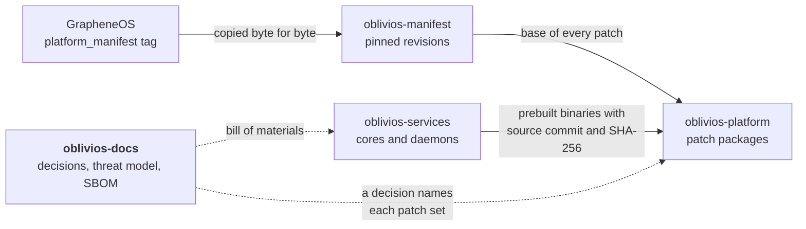

<h1 align="center">oblivios-docs</h1>

  <strong>The decisions, threat model and bill of materials behind ObliviOS.</strong> 
  The published records of the project: why it is built the way it is, what it does not claim, and how to check what the other three repositories contain.

  
  
  

> **Stage: source only.** No builds, images or update service are offered, and no device is supported (ADR-171).

## The four repositories

| Repository | Holds |
| --- | --- |
| [`oblivios-manifest`](https://github.com/Beau4201/oblivios-manifest) | The pinned GrapheneOS and AOSP revisions the patches apply to, and how each baseline was chosen. |
| [`oblivios-platform`](https://github.com/Beau4201/oblivios-platform) | The patch packages: ObliviOS added to GrapheneOS source. |
| [`oblivios-services`](https://github.com/Beau4201/oblivios-services) | The platform-independent logic and native daemons that some packages ship as prebuilt binaries. |
| **`oblivios-docs`** | This repository. |

## What is in here

| Document | What it is |
| --- | --- |
| [Decision log](docs/governance/decision-log.md) | Every product and security decision as one numbered entry (ADR-nnn) with its status, rationale, consequences and the trigger that reopens it. The reference for behaviour. |
| [Threat model](docs/security/threat-model.md) | Scope, assets and what the project does not claim to defeat. |
| [Capability boundaries](docs/security/capability-boundaries.md) | For each service: allowed inputs and outputs, privileges and explicit denials. |
| [Device support policy](docs/devices/support-policy.md) | The gate a device must pass before it counts as supported. No device does. |
| [Supply chain and signing](docs/release/supply-chain-and-signing.md) | The controls for signing, updates and incidents. |
| [Licensing and branding review](docs/research/licensing-and-branding-review.md) | The licence inventory, the review gates, and the legal risk accepted per item in this stage. |
| [Documentation standard](docs/documentation-standard.md) | Where each kind of fact lives. |
| Engineering notes | What was learned building one area, for the next person: [AirPods](docs/architecture/airpods-engineering-notes.md), [app drawer](docs/architecture/app-drawer-engineering-notes.md), [boot](docs/architecture/boot-engineering-notes.md), [Data Map](docs/architecture/datamap-engineering-notes.md), [Duress Unlock](docs/architecture/duress-engineering-notes.md), [grab detection](docs/architecture/grab-detection-engineering-notes.md), [keyboard](docs/architecture/keyboard-engineering-notes.md). |
| [`site/`](site/README.md) | The source of the website `oblivios.org`, built with Astro. |
| [`sbom/`](sbom/README.md) | The software bill of materials of the four repositories. |
| [`tools/`](tools/LICENSE) | The scripts that reproduce a documented check. |

### Reading the decision log

The decision log is a table of about 660 KB in which one entry is one long line, so do not open it whole. Find an entry by its
number with a pattern search such as `grep -n '^| ADR-214 ' docs/governance/decision-log.md`. The columns are ID, date, decision, status,
rationale, consequences and review trigger. A decision changes only through a new entry that names what it supersedes.

## Verify what the repositories contain

`sbom/` holds a CycloneDX 1.6 and an SPDX 2.3 document, a SHA-256 for every file of the four repositories, and the registry and upstream
evidence they were built from (ADR-244). They are made by `tools/sbom/build-sbom.py`, which fails when a file, a hash, a commit, a
licence or a claim of a NOTICE file is not supported. `sbom/README.md` gives the commands to check it and says what it does not claim.

## What this repository is

The documents are authored in a private repository and copied here by a script that rewrites host and path
details to neutral wording and checks the result. If you find an error, open an issue: I correct it at the
source and the snapshot follows.

A link to a record that is not published is shown as plain text. A record cited by path in the decision log
or in an engineering note may therefore not exist here.

## Scripts

`tools/` holds the scripts that reproduce a documented check, each with a host path replaced by a parameter:
`PLATFORM_TREE` names an AOSP source tree. Scripts that only operate the private build and signing hosts are
not published. The scripts are licensed Apache-2.0, see `tools/LICENSE`.

## Earlier names

The project was named AegisOS, SovereignOS and FreeholdOS before ObliviOS (the rename is ADR-224). The decision log and the
other records keep the names that were in use when they were written.

## Security

Do not open a public issue for a vulnerability. See [`SECURITY.md`](SECURITY.md) for the contact, the PGP key and what to expect.

## Licence

The documents are licensed CC-BY-4.0, see `LICENSE`. The name ObliviOS and its logo are not licensed.
ObliviOS is based on GrapheneOS; it is not affiliated with or endorsed by the GrapheneOS project.
