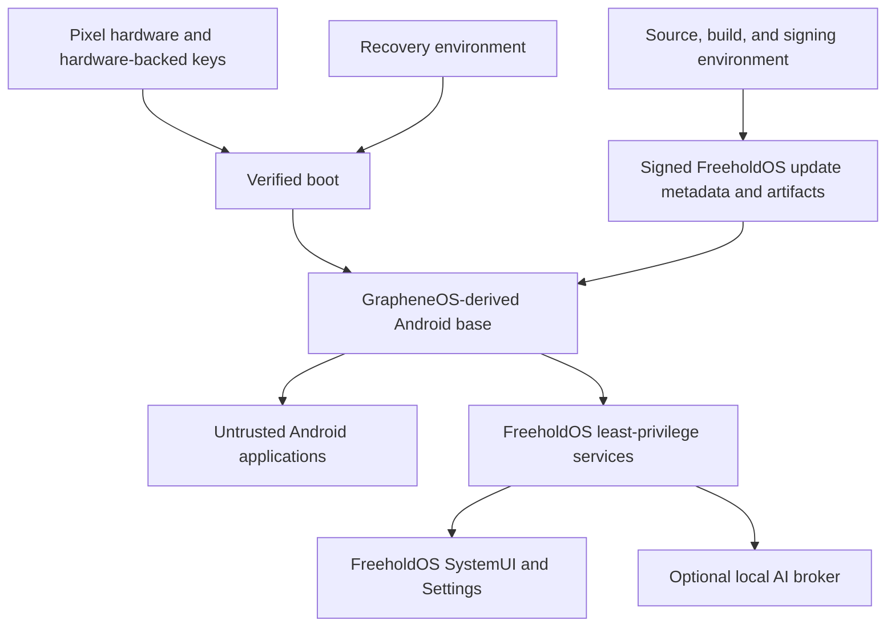

# FreeholdOS Threat Model

## Scope and objectives

This model covers FreeholdOS-owned additions, its GrapheneOS-derived base, release
operations, and supported Pixel devices. It does not claim to defeat a fully
compromised hardware root of trust, unknown vulnerabilities, or network-level
denial of service. Its objectives are confidentiality of user data and keys,
integrity of boot/update/policy decisions, availability of essential phone
functions, isolation between apps and Worlds, and accountable remediation.

## Assets

| Asset | Required property |
| --- | --- |
| User data and decryption keys | Never exposed to an untrusted app, service, model, or operator. |
| Authentication secrets | Hardware-backed where supported and never exported by FreeholdOS. |
| App and World isolation | No access across boundaries without an explicit Android/FreeholdOS sharing path. |
| Network policy | Only typed, authorized policy operations mutate it; every mutation is auditable. |
| Signed update trust | Only FreeholdOS-authorized verified artifacts install; downgrade attacks are rejected. |
| Recovery authority | Restores a trusted state without weakening verified boot or disclosing protected data. |
| Guardian audit records | Minimized, access-controlled, and integrity-protected within the device model. |
| AI broker authority | Limited to validated typed requests; an untrusted prompt gains no capability. |

## Trust boundaries

Applications, network content, update-hosting infrastructure, prompts, and
build workers are untrusted by default. Production signing keys and
hardware-backed verified-boot keys are high-trust assets.

## Attacker catalogue

| Attacker | Path | Mitigation | Detection | Recovery | Residual risk |
| --- | --- | --- | --- | --- | --- |
| malicious app | Misuses permission, overlay, accessibility, background work, or IPC. | Sandbox, scopes, Guardian rules, typed policies. | Unexpected resource use, policy denial, anomalous pattern. | Revoke, restrict, freeze, or remove via typed action. | Granted permissions may be abused before detection. |
| compromised app update | Adds SDK, permission, endpoint, or background behaviour. | Difference scanning, signature verification, baseline comparison. | Manifest, SDK, destination, or event change. | Restrict, isolate, roll back when supported, or remove. | Dormant/server-controlled abuse may evade analysis. |
| Tracker SDK | Exfiltrates identifiers or correlates activity. | Per-app networking, classification, profile isolation. | Unexpected destination, volume, or timing. | Block destination or background traffic. | Encryption and domain fronting limit certainty. |
| network attacker | Observes, manipulates, or blocks traffic. | TLS, certificate validation, signed updates. | TLS or update signature failure. | Reject connection/artifact and use trusted recovery path. | Availability can be denied. |
| stolen device | Attempts offline access or coercive use. | Encryption, hardware keys, lockscreen, auto-reboot, profiles. | Failed unlock patterns and configured alerts. | Lock/reboot per user policy. | An unlocked current session remains exposed. |
| Co-located adversary with legitimate access | Views, or compels an unlock of, the owner's own device (partner, family member, employer) and inspects location-sharing state. | Location Anchor's no-persisted-history design: no on/off event is ever written down, so there is nothing to find. | N/A by design — only the current toggle state is observable; there is no history to detect. | N/A — there is no past record to recover or protect. | The status-bar icon (drawn from an interchangeable glyph set) is visible to this adversary if they view the unlocked screen while anchoring is active; the glyph set raises the bar against a casual glance, not against a repeat or attentive observer who already knows it. |
| Coercive adversary compelling unlock | Physically or legally forces the owner to unlock the device on demand (border search, robbery, an abusive partner) and inspects whatever is shown. | Duress Unlock: a second, separately-credentialed, fully isolated decoy profile that a distinct PIN routes directly into at the primary lockscreen, with the real profile force-stopped and never shown. | N/A by design — a decoy unlock is, from every observable signal, a normal unlock. | N/A — there is no real-profile state exposed to recover from; the owner simply unlocks normally with the real credential at the next opportunity. | A sufficiently informed adversary who already suspects FreeholdOS ships this feature could demand proof the shown profile is the only one, or examine the OS image offline for the dual-credential-check code path; timing side-channels between a wrong PIN, a decoy-match PIN, and a real-match PIN are a residual risk pending constant-time implementation. |
| Physical attacker | Uses ports, boot mode, firmware downgrade, or hardware access. | Locked bootloader, verified boot, rollback protection, USB policy. | Boot failure or rollback rejection. | Refuse untrusted boot and restore signed system. | Sophisticated hardware attacks can exceed OS controls. |
| Compromised build worker | Alters source, dependency, or artifact. | Pinned manifest, isolated builds, provenance, reproducibility, offline signing. | Hash/provenance mismatch. | Quarantine, rebuild, rotate exposed credentials. | Coordinated source/reviewer/signing compromise is high impact. |
| Compromised update server | Substitutes, stales, or withholds updates. | Signed metadata, rollback protection, mirrors, staged channels. | Signature/version/availability anomaly. | Reject, pause, publish advisory, use factory image. | Availability can be reduced. |
| Hostile prompt | Tries to induce AI disclosure or action. | Minimized inputs, typed allow-list, validation, no shell/root/file authority. | Invalid tool request or denied capability. | Deny, audit, explain safely. | Explanation quality can still be manipulated. |

## Privileged-path abuse cases

| Abuse case | Required control | Test evidence |
| --- | --- | --- |
| Guardian data overcollection | Schema and caller enforcement reject personal-content fields. | Negative schema test with prohibited content. |
| Guardian unsafe remediation | Registered IDs, preconditions, verification, rollback, and audit are mandatory. | Unknown-action, failed-verification, and rollback tests. |
| AI privilege escalation | Broker denies shell, root, arbitrary Binder/file reads, and direct policy mutation. | Typed-tool denial tests. |
| Cross-World data leakage | Profile-bound storage/policy and explicit user share contract. | Cross-profile isolation and approved-share tests. |
| Recovery bypass | Signed factory/recovery artifacts and verified-boot-preserving flow. | Tampered-image and interrupted-recovery tests. |
| Stale Guardian Overview protection state | Lifecycle gating, safe rollback, and audit so a protection displayed as active after a verification or Undo failure is never left showing stale success. | GRD-005 and GRD-006 evidence. |
| Guardian Overview summary overcollection or export | Schema rejection and local-only retention for derived `GuardianActiveProtectionV1`/`GuardianMeaningfulChangeV1` summary data; no export path. | GDN-005 and GDN-006 evidence. |
| Location Anchor emergency/theft-recovery bypass leakage | Emergency location is checked before the anchor and always wins, unconditionally; the theft-recovery lookup defaults to the real fix and is owner-overridable only through an explicit setting. | Simulated-emergency fix-source test; theft-recovery default-path and override-setting tests. |
| Location Anchor history persistence | No component may write a timestamped record of Location Anchor's on/off transitions, anchor coordinates, or duration to any store, log, or backup path. | Negative test: a full toggle cycle produces zero new persisted artifacts beyond the single current-state record. |
| Duress Unlock reveals the real profile under a decoy credential | The keyguard hook must route a decoy-credential match exclusively to the decoy profile; on any hook failure or error path it must fail closed to today's single-credential behavior, never falling through to reveal the real profile. | Simulated decoy-vs-real credential collision and hook-failure tests confirming fail-closed-to-normal-path behavior. |
| Duress Unlock persists evidence of its own use | No component may write a timestamped record of which credential was entered, when a decoy match occurred, or which profile was last foregrounded, to any store, log, or backup path; a successful decoy match must never count as a failed attempt against the real profile's own lockout counter. | Negative test: a full setup-and-decoy-unlock-and-return cycle produces zero new persisted artifacts beyond the pre-existing profile/credential registration. |
| Malformed proprietary Bluetooth packet compromises a privileged parser | Memory-safe implementation where feasible, bounded schemas, fuzzing, malformed-input tests, minimal parser authority. | AIR-015. |
| Stale AirPods location is presented as current | Evidence state and timestamp are mandatory; current state expires immediately when its observation ends. | AIR-005, AIR-006. |
| One AirPods component's location is assigned to another | Component-specific identity and record; no group inference. | AIR-002, AIR-004. |
| Malicious app reads AirPods accessory location | Profile-bound private storage and no exported content provider or broad Binder interface. | AIR-011. |
| Phishing through the optional Apple Find My setup | Exact allow-listed HTTPS origin, browser-owned authentication, visible hostname, no embedded credential surface. | AIR-013. |
| Apple Find My service outage breaks ordinary AirPods use | The Apple path remains optional and external; local finding and Bluetooth audio remain independent. | AIR-014. |
| AirPods firmware update silently changes the proprietary protocol | Exact capability registry; changed firmware downgrades to `UNKNOWN`; revalidate before restoring the claim. | AIR-016. |
| Bonded-device-scoped identity patch regresses to a device-wide spoof | The bonded-BD_ADDR scoping condition is itself part of the reviewed patch and its own test case; any change to the scoping condition requires the same security-case review as the original patch. | AIR-021. |
| The scoped non-SDK API exemption or identity patch is reused by an unrelated feature to justify broader hidden-API or Bluetooth-stack access | The exemption and patch are named and scoped to the AirPods compatibility service alone in the platform tree; any other consumer requires its own separate security case. | AIR-022. |
| A third-party app binds the AirPods device-settings provider, reads the header icons through the icon provider, or opens the AirPods pages | The provider service and the pages require `android.permission.BLUETOOTH_PRIVILEGED`, which the Settings app holds; the icon provider is not exported and grants read access to `com.android.settings` only, and serves a fixed allow-list of bundled images and never a caller-supplied path. | AIR-035. |
| Device metadata is rewritten to point Settings at another service | Only `AirPodsApp` writes the AirPods metadata keys and the platform removes them on forget. The recommended write route is a narrow setter behind `MANAGE_AIRPODS_IDENTITY` (key allow-list, bonded and registered devices only), not `BLUETOOTH_PRIVILEGED`; the owner confirmed it and it is implemented, uncompiled (ADR-117, ADR-119). | AIR-034, AIR-036. |
| The UI shows unformatted device data or a hard-coded string | Every user-visible string is an Android resource; values from the device are formatted through locale formatters and validated in `airpods-core` before display. | AIR-033. |
| Real Apple Find My network participation is reintroduced via stored Apple credentials or emulated device attestation | Refused as a hard non-goal, not merely deprioritized; any future proposal requires an explicit, separate, owner-approved decision. | N/A — refused by design, no implementation exists to test. |
| A third-party app reads the Data Map | `READ_DATA_MAP` is protection level `signature` plus `privileged` and allow-listed for `DataMapApp` only; its own SELinux domain restricts `find` of the service (`system_app` and `traceur_app`, which may find every other service type, are excluded from it); every method uses the calling user. The permission check alone does not separate the app from apps of the system uid, which hold every permission, so SELinux is the gate. | `MAP-001`, `MAP-002` |
| The decoy session or another user sees the owner's destinations or retention setting | Separate store and file per user; no user-id argument; the decoy has an empty store. | `MAP-003` |
| The history becomes forensic evidence of app use | Memory only by default; history is opt-in with a user-chosen duration, stored encrypted per user, expiring, clearable and outside backup. | `MAP-004`, `MAP-005`, `MAP-006` |
| Collecting slows or breaks name resolution or connections | Non-blocking O(1) callback, exceptions swallowed, drop on overload, callback removable. | `MAP-007`, `MAP-008` |
| A hostile app floods lookups to evict other apps' entries or to inject text into the interface | Per-uid and global caps with same-uid eviction; hostname validation; hostnames rendered as plain text only. | `MAP-009` |
| The map claims a link, an owner or a relation it cannot know | Links say "could be linked" with evidence; `unknown` never creates a link; every owner label, base and relation has a source id and an entry without one is rejected at build time. | `MAP-010`, `MAP-017` |
| The collector or the app is reused as telemetry or an export channel | The app declares no network permission; no export API; denial list in the capability rows; code review item. | `MAP-011`, `MAP-013` |
| The package list the app holds is used to fingerprint the owner | `QUERY_ALL_PACKAGES` is held for icons and labels only, the app cannot send anything off the phone, and it keeps no file. | `MAP-013`, `MAP-015` |
| A map shows a place that reads as the owner's own or as where data went | The owner's location is never read; a company base is labelled a base, with the words "not where its servers are"; a server place (ADR-161) is drawn apart with a hollow marker and worded "hosted in", never as a company's country or as where data went; services with no known place are listed, not placed. | `MAP-012`, `MAP-016`, `MAP-033` |
| The address data is wrong or altered and the map shows a false server place | The file ships in the signed system image and is pinned by SHA-256; a city is drawn when the city data and the country data name the same country, or the country data names none, and a country alone only from the country data; an anycast prefix or a DNS-steered network gets no place (the operator names are matched as whole words, ADR-164 (3)), and a disagreement says "location uncertain"; the interface says "hosted in" and names the operator. | `MAP-033` |
| An address string or the address file crashes `system_server` or stalls the netd callbacks | The lookup runs on the service thread, never in the callback; the reader never throws on input, resolves no name, refuses a file whose sections are out of place or larger than 256 MB, and the service then runs with no address data. | `MAP-032` |
| A contacted address outlives its lookup | Only the kind, country, city, coordinates, AS number and operator are kept, in memory with the row; the address is neither stored, persisted nor sent in the snapshot, and the history keeps the server place of a row only when the user chose to. | `MAP-032`, `MAP-034` |
| One long row makes the whole history unreadable | A row of the history file is at most 1024 characters, the bound of the decoder; the encoder leaves a place out of a row that would pass it and a row that is too long even without one is not written, so that the decoder never refuses a file for one row. The reader refuses a file over 64 MB and an unreadable history is started again, so the writer keeps the file under 56 MB by leaving out the oldest days (never the newest). | `MAP-034` |
| The reply to the app outgrows the Binder buffer | The entries of a reply are bounded in bytes (512 KB, counted as the parcel holds them, the longest names included) as well as in number, and the evidence of a link is cut to 16 service keys (300 links at most); the rows seen most recently that fit are kept. | `MAP-035` |
| A damaged page of the mapped address file stops `system_server` | The file is mapped read-only from `/system`, which dm-verity verifies; a block that fails verification fails every mapped system file alike (the dex files of `system_server` included), so the file adds no case of its own `[assumption: not tested on a device]`. | `MAP-032` |
| Two apps join one person through a stable device value that an app reads without a permission | The five unit `ro.boot.*` properties are made unreadable by apps and by the app zygotes, and the bias estimates of the uncalibrated sensors are folded into the readings for every app uid `[measured on the lynx image 2026101406; stallion not run]`. Boot identity (`boot_id`, boot time) and the model, build, locale and time zone stay readable and are a documented residual (ADR-167). | IDS-001 (host), IDS-002 (build), IDS-003, IDS-004, IDS-008 and IDS-009 pass; IDS-005 and IDS-007 are partial (compass, eSIM and stallion not run). |
| An app reads the bias through a direct sensor channel, which bypasses the sensor service connection | The HAL accepts such a channel from an ordinary app (measured); `configureChannel` refuses the three types for an app uid (ADR-167 (2)) `[measured on the lynx image 2026101406]`. | IDS-006 (configured on the baseline, refused with the patches). |

## Supply-chain abuse cases

The controls below are specified in
[`docs/release/supply-chain-and-signing.md`](../release/supply-chain-and-signing.md).
They apply before a signed FreeholdOS artifact exists and remain in force for every
channel.

| Abuse case | Attack path | Required mitigation and detection | Recovery and validation evidence |
| --- | --- | --- | --- |
| compromised source fetch | A source origin, manifest, tag, prebuilt, or Pixel input is substituted before the build. | Locked manifest; primary-origin retrieval; tag/signature, commit, hash, origin, and terms verification; source-lockfile comparison. | Quarantine input, rebuild from verified source, investigate provenance mismatch; reject mismatched-source test. |
| compromised build worker | A worker alters source, tools, configuration, or unsigned output. | Ephemeral isolated worker; pinned host/tool image; no production key; immutable logs; independent reproducible build and hash comparison. | Quarantine worker and credentials, rebuild independently; worker-isolation and reproducibility tests. |
| signing-key theft | A channel key is copied, accessed without authorization, or used for an unapproved candidate. | Separate channel keys; stable offline storage; restricted ceremony access; recorded approvals; independent signature verification; rotation/revocation triggers. | Contain and revoke suspect key, execute emergency replacement and transition; key-compromise rehearsal. |
| malicious OTA metadata | An update host serves forged, stale, wrong-channel, wrong-device, expired, or hash-mismatched metadata. | Signed, versioned, expiry-bounded, hash-bound metadata with channel/device checks and audit events. | Reject metadata, pause/withdraw rollout if necessary, publish advisory; signature, expiry, channel, device, and hash rejection tests. |
| rollback attempt | An attacker attempts a downgrade or update that violates rollback-index policy. | Update preflight and platform rollback-index enforcement; no downgrade or index-bypass procedure. | Reject the update and preserve audit evidence; rollback-rejection test on supported hardware. |
| recovery-image substitution | A substitute or tampered factory/recovery image attempts to replace the trusted recovery route. | Separately signed device-compatible recovery/factory artifacts; artifact/hash verification; release-key validation; verified-boot-preserving relock flow. | Reject image and use verified artifact; tampered-image, interrupted-recovery, factory-install, and relock tests. |

## Security review rule

No privileged FreeholdOS component enters implementation until its caller,
permissions, data minimization, audit event, error behaviour, and test method
appear in `docs/security/capability-boundaries.md`.
